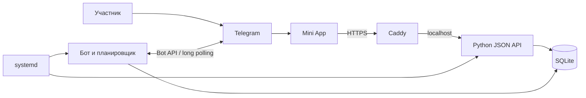

# Вместе — Telegram Mini App для групповых челленджей

Telegram-бот и мобильное веб-приложение для ежедневных упражнений, напоминаний и командного прогресса. Организатор задаёт программу, участники отмечают результаты в Telegram и видят календарь выполнения.

Проект прошёл полный путь от разработки интерфейса и API до развёртывания на облачном Linux-сервере и переноса данных между провайдерами. Разработка и настройка выполнялись с помощью AI-инструментов; описание ниже отражает реализованные функции и фактически выполненную работу.

## Возможности

- Челлендж с датой начала, длительностью и 1–8 ежедневными заданиями.
- Настраиваемые упражнения, единицы измерения, варианты результата и время напоминания.
- Личные уведомления в Telegram и кнопки для записи результата.
- Мобильный интерфейс: задания на сегодня, календарь, личный прогресс и команда.
- Вступление по коду с подтверждением видимости результатов внутри команды.
- Роли участника и организатора; создание, пауза и возобновление челленджа.
- Изменение результата без двойного подсчёта и отмена сегодняшней отметки.
- Деморежим с вымышленными данными, не требующий токена бота.

## Технологии

| Область | Реализация |
| --- | --- |
| Backend | Python, стандартный HTTP-сервер, JSON API |
| Telegram | python-telegram-bot, long polling, JobQueue |
| Данные | SQLite, транзакции, журнал WAL |
| Frontend | JavaScript, HTML, CSS, Telegram Web App |
| Авторизация | Проверка подписи Telegram initData через HMAC-SHA256 |
| Конфигурация | Переменные окружения, python-dotenv |
| Развёртывание | Ubuntu, SSH, systemd, Caddy, HTTPS, UFW |
| Проверки | unittest: 15 тестов домена и HTTP API |

## Архитектура



Бот, планировщик и HTTP API работают в одном процессе. Caddy обслуживает публичный HTTPS, а Python слушает только localhost. Состояние хранится на сервере; клиент не определяет права администратора.

## Работа с сервером

В ходе развёртывания были выполнены:

1. Подбор облачной конфигурации и оценка полной стоимости с диском и публичным IPv4.
2. Подключение к Ubuntu по SSH-ключу, установка окружения Python и зависимостей.
3. Настройка отдельного системного пользователя и службы systemd с автозапуском, перезапуском при сбое и ограничениями доступа.
4. Настройка Caddy как reverse proxy с TLS-сертификатом и HTTPS.
5. Ограничение входящих соединений до SSH, HTTP и HTTPS.
6. Диагностика DNS, маршрутизации, firewall и соединения с Telegram API; настройка таймаутов и повторных попыток.
7. Перенос приложения и согласованной копии SQLite с прежнего сервера. Старый polling-процесс был остановлен перед запуском нового.
8. Проверка целостности базы, HTTPS, команд бота и открытия Mini App в Telegram.
9. Настройка ежедневных локальных резервных копий с ограниченным сроком хранения и отдельной копии для миграции.

Развёртывание проверялось для небольшой группы. Нагрузочное тестирование на сотни пользователей не проводилось. Резервная копия на том же сервере не заменяет независимое хранилище.

## Безопасность и приватность

- API проверяет подпись и срок действия Telegram initData.
- Права организатора задаются на сервере через ADMIN_IDS.
- Доступ к результатам ограничен членством в челлендже.
- Токен, Telegram ID пользователей, рабочая база, SSH-ключи, реальные IP и адреса инфраструктуры не входят в репозиторий.
- Примеры конфигурации используют только placeholders.
- В деморежиме данные вымышлены, изменения живут только до перезагрузки страницы.

## Быстрый запуск

Требуется Python 3.10+; для сервера использовался Python 3.12 на Ubuntu 24.04.

```bash
python3 -m venv .venv
source .venv/bin/activate
python -m pip install -r requirements.txt
cp .env.example .env
```

Заполните локальный файл .env:

| Переменная | Назначение |
| --- | --- |
| BOT_TOKEN | Токен собственного бота из BotFather |
| ADMIN_IDS | ID организаторов через запятую |
| MINIAPP_URL | Публичный HTTPS-адрес приложения |
| TIMEZONE | Часовой пояс расписания, по умолчанию Europe/Moscow |
| HOST / PORT | Адрес HTTP API; по умолчанию 127.0.0.1:8080 |

```bash
python server.py
```

Для работы из Telegram нужен доступный HTTPS-адрес. Примеры Caddy и systemd находятся в корне репозитория. Не запускайте два polling-процесса с одним токеном.

### Посмотреть интерфейс без Telegram

Запустите статический сервер:

```bash
python -m http.server 8000 --directory static
```

Откройте http://localhost:8000/?demo=1. Этот режим показывает интерфейс и не отправляет сообщения, не использует настоящую базу и не заменяет серверный запуск.

### Проверки

```bash
python -m unittest -v test_app.py
```

Тесты покрывают проверку Telegram-подписи, членство и согласие, календарь, изменение результатов, паузу, конкурентную запись и HTTP API.

## Структура

```text
server.py                         # HTTP API, бот, планировщик
domain.py                         # правила челленджа и работа с SQLite
static/                           # интерфейс Mini App
test_app.py                       # тесты
import_users.py                   # импорт пользователей из старой версии
.env.example                      # конфигурация без секретов
Caddyfile.example                 # пример HTTPS reverse proxy
challenge-miniapp.service.example # пример службы systemd
```

## Ограничения и развитие

Сейчас поддерживается один общий активный челлендж. Для более крупной нагрузки стоит добавить отдельные процессы API и бота, полноценный веб-сервер, внешние резервные копии и метрики. Доставка уведомлений зависит от доступности Telegram, подписки через /start и настроек пользователя.

## Формулировка для резюме

> Разработал и развернул с помощью AI-инструментов Telegram Mini App для групповых челленджей: Python API, SQLite, мобильный интерфейс, проверка Telegram initData, роли и напоминания. Настроил Ubuntu VPS, SSH, systemd, Caddy/HTTPS и firewall; выполнил перенос базы между серверами, диагностику сетевых проблем и резервное копирование.

## Обновление упражнений

Одна ежедневная рассылка объединяет все упражнения; организатор меняет её время без пересоздания челленджа. Кнопка «Как выполнять» открывает увеличенную GIF-инструкцию для приседаний, отжиманий с колен и планки. GIF загружаются только при открытии инструкции. Планка учитывается в секундах. Личные данные доступны после входа через Telegram; обычная браузерная ссылка показывает стартовую страницу и демо.
